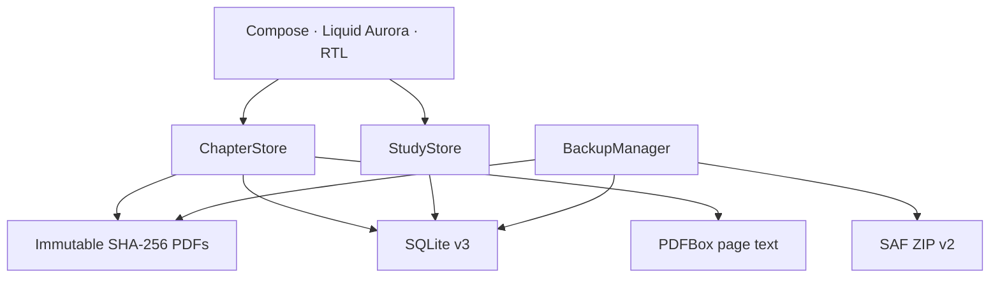

# Architecture — v0.6.1-alpha

## Storage contracts

- `chapters`: immutable PDF identity and metadata, page count and last page.
- `page_notes`: one local note per chapter SHA and zero-based page index.
- `page_text`: extracted embedded text per real PDF page; derived and re-indexable.
- `study_items`: source-linked High-Yield, Flashcard and MCQ content plus current schedule.
- `study_reviews`: immutable grading events used by mistake history.
- Foreign keys and cascading deletes are enabled. SQLite schema is v3; v1/v2 upgrades add tables without dropping data.

## Reader and search

PDF display uses Android `PdfRenderer` on `Dispatchers.IO`, limits the rendered bitmap to roughly 1900×2400 and closes renderer/page/file descriptors. Pinch zoom scales the bitmap; tiled rerendering is future work. PDFBox loads the document with disk-backed scratch and extracts one page at a time. Search uses bounded SQLite `instr(lower(...))`, returns at most 100 matching pages and does not claim semantic or OCR capability.

## Backup

Backup v2 contains `manifest.json`, `documents/<sha>.pdf`, `notes.jsonl`, `study_items.jsonl` and `study_reviews.jsonl`. Export holds one read transaction for a consistent database snapshot and hashes each PDF while streaming. Restore stages and validates every entry, document digest/page count and JSONL record before writing live data, then inserts within a transaction. Existing records and notes win conflicts. v1 PDF+notes archives remain supported.

Backups are plain, unencrypted ZIP files. Android automatic cloud backup/device transfer is excluded; the user initiates export/import through the Storage Access Framework.

## Build and verification boundary

The project bundles the official Gradle 8.13 wrapper JAR and checksum, plus a stable debug-only signing key. JVM integration tests use Robolectric SDK 28 and a controlled `PdfRenderer` shadow; PDFBox extraction itself runs against a real four-page PDF fixture. Native rendering, Compose interaction, performance and update installation need emulator/device tests.
